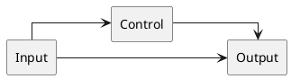
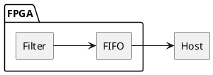

# Tutorial: diagramas de bloques con PlantUML

## 1. Archivo mínimo

Guarda como `bloques.puml`:



Genera los resultados después de instalar los conversores:

```bash
plantuml2svg bloques.puml
plantuml2pdf bloques.puml
```

Los alias `A`, `B` y `C` identifican bloques; los textos entre comillas son
sus etiquetas visibles. Los archivos comienzan con `@startuml` y terminan
con `@enduml`. Los comentarios de una línea empiezan con `'`.

## 2. Bloques y etiquetas

Estas son alternativas para declarar elementos:

```plantuml
rectangle "Digital filter" as FILTER
component "SPI interface" as SPI
database "Buffer" as BUFFER
rectangle "Clock\ncontrol" as CLOCK
```

`\n` divide el texto en líneas. Usa nombres internos únicos y sencillos,
sin espacios, para conectar los elementos.

## 3. Conexiones

```plantuml
A --> C : Data
A ..> B : Enable
B --> C
```

* `-->`: flecha sólida.
* `..>`: flecha discontinua.
* `: Data`: etiqueta de la conexión.
* `-right->`, `-left->`, `-up->` y `-down->`: indicaciones direccionales.

PlantUML organiza los elementos automáticamente. La dirección es una indicación
para el motor, no una coordenada ni una selección exacta del puerto.

## 4. Líneas ortogonales y distribución

```plantuml
left to right direction
skinparam linetype ortho
skinparam nodesep 40
skinparam ranksep 50
```

`linetype ortho` solicita segmentos horizontales y verticales. `nodesep` y
`ranksep` ajustan separaciones del motor Graphviz. Las etiquetas de conexiones
ortogonales pueden quedar mal colocadas: revisa el resultado visualmente.

Para sugerir un orden sin dibujar una conexión visible, puedes probar:

```plantuml
A -[hidden]down-> B
```

No añadas muchas restricciones a la vez. Empieza con las conexiones reales y
ajusta una dirección o separación por iteración. Si necesitas puertos geométricos
exactos y rutas fijas, TikZ ofrece más control.

## 5. Colores y estilos

```plantuml
skinparam shadowing false
skinparam defaultFontName DejaVu Sans
skinparam defaultFontSize 14
skinparam ArrowColor #334155
skinparam rectangle {
    BackgroundColor #EFF6FF
    BorderColor #334155
    RoundCorner 8
}
```

Coloca estas opciones antes de declarar los bloques. La fuente debe estar
instalada en el equipo. Para colorear un solo bloque:

```plantuml
rectangle "Control" as B #FFF4CC
```

## 6. Fondo transparente u opaco

Elige una de estas líneas:

```plantuml
skinparam backgroundColor transparent
skinparam backgroundColor white
skinparam backgroundColor #F5F5F5
```

No uses las tres juntas: la última configuración prevalece.
La transparencia del fondo no elimina el relleno de los bloques.
Los conversores no añaden un fondo adicional.

## 7. Agrupar bloques



Un `package` dibuja un contenedor y agrupa elementos, pero no fija sus coordenadas.

## 8. Estilo compartido

Guarda las opciones comunes en `style.puml`, sin `@startuml` ni `@enduml`:

```plantuml
skinparam linetype ortho
skinparam shadowing false
skinparam backgroundColor transparent
```

Inclúyelo desde otro archivo de la misma carpeta:

```plantuml
@startuml
!include style.puml
rectangle "Input" as A
rectangle "Output" as B
A --> B
@enduml
```

Las rutas relativas se resuelven desde la carpeta de la fuente con estos
conversores. Revisa cualquier `!include` remoto: podría acceder a la red.

## 9. Revisar el resultado

Edita con Neovim o VS Code y ejecuta el conversor después de guardar.
Para revisar PDF con Okular:

```bash
plantuml2pdf bloques.puml
okular bloques.pdf
```

Si hay un error de sintaxis, el comando falla sin sustituir el resultado anterior.
Consulta la referencia oficial de [componentes](https://plantuml.com/component-diagram)
y [línea de comandos](https://plantuml.com/command-line) para ampliar los ejemplos.
